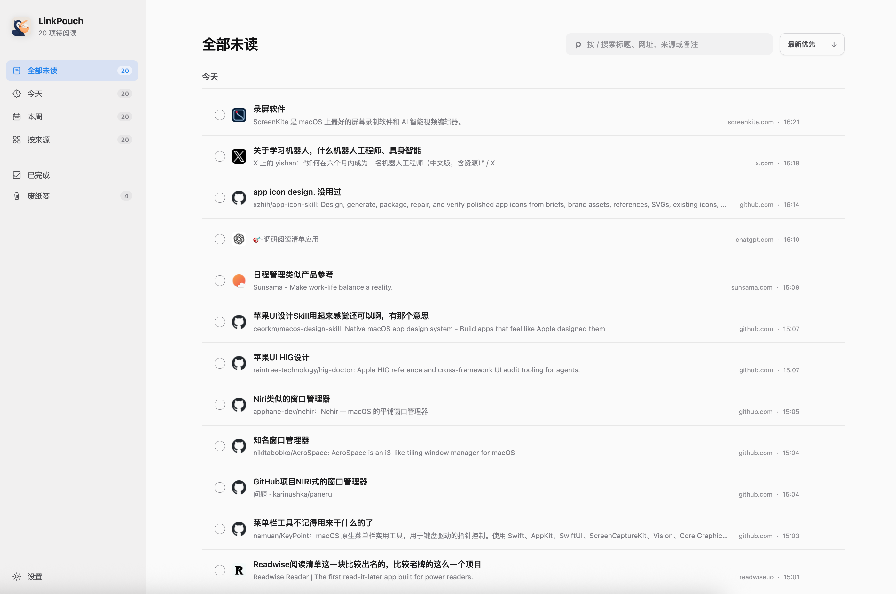

<p align="center">
  
</p>

# LinkPouch

A local-first Chromium extension for collecting page content, text selections, and images, with full-text search and a directory-backed gallery.



## Install

1. Download the [latest release](https://github.com/RunMintOn/LinkPouch/releases/latest) ZIP.
2. Extract it to a permanent folder.
3. Open `chrome://extensions` and enable **Developer mode**.
4. Select **Load unpacked** and choose the extracted `LinkPouch` folder.
5. Open `chrome://extensions/shortcuts` if Chrome did not assign the suggested shortcuts.

To update, replace the files in the existing extension folder with the next release, then select **Reload** for LinkPouch on `chrome://extensions` and refresh open collection pages. Keep the same folder and installation rather than uninstalling or loading a second copy, so the extension keeps its local data.

## Development

Requirements: Node.js 22+ and Chrome 127+.

```bash
npm install
npm test
npm run build
```

Load the generated `dist/` directory from `chrome://extensions`:

1. Enable **Developer mode**.
2. Select **Load unpacked**.
3. Choose this project's `dist/` directory.
4. Open `chrome://extensions/shortcuts` if Chrome did not assign the suggested shortcuts.

Suggested macOS shortcuts:

- `Option+Shift+S`: save selected text, or capture the active page when nothing is selected.
- `Option+Shift+Q`: open or focus the Queue.

Chrome or macOS may reserve a suggested shortcut. Assign another combination from the extension shortcuts page when needed.

## Behavior

Capture extracts content with Defuddle and persists it before opening Quick Capture. The popup previews what was saved. Enter confirms the note; Shift+Enter adds a line; Escape dismisses note editing without removing the captured item. With an empty note, press 1–9 to insert a configured preset. To begin a note with ordinary numbers, type a space first; existing text and IME composition are not intercepted.

Text selections from the same URL are separate items. Full pages still deduplicate by URL. Search includes saved body text. All saved includes both Unread and Done items, excluding Trash.

The collection opens as a masonry wall of images, text, and notes, grouped by Today, This week, and Earlier. Tall images fill the card width and are cropped at the bottom; the saved-content panel keeps the full image. Click a card to read its saved content in the right-hand panel without rearranging the wall; Escape or a click outside closes the panel. Click the title to edit it. Title and note changes save automatically. **Source page** opens the original using your configured tab behavior. Cards use saved remote image URLs, not downloaded copies. Older items without saved content still show their titles and notes.

Keyboard browsing: `/` focuses search and selects its text, including from a preview when not editing. In search, Up/Down selects a result and Enter opens it. The preview starts in reading mode: Up/Down and Page Up/Down scroll its content, while Left/Right moves through the current results. Escape leaves title/note editing first, then closes the preview and returns focus to its entry point. In search, Escape clears the query without leaving the field; another Escape leaves an empty search. Text editing and IME composition keep their normal keys.

The wall initially renders 100 items and loads another batch near the bottom. Search and keyboard navigation still cover the entire collection, including items not rendered yet.

## Collect images

On an X/Twitter post detail page, hover over the image group to reveal **↓ 收图 · N** in its top-right corner, or focus it with the keyboard. Click it to collect the post's images. You can also use **Download images** in Quick Capture or the saved-content view.

The first download opens Gallery and asks you to choose an image directory. Images are written directly to that directory, requesting original-size X images, with no duplicate blobs in extension storage. Later downloads use the saved directory permission when available. Gallery reads the saved files, supports enlargement, and links back to each source post. Image-only collection preserves the source without adding an unread task.

Saving a page's body does **not** automatically download its images. Embedded remote images may still depend on the original website.

Bodies, notes, and image/source metadata stay in `chrome.storage.local`; authorized directory handles are kept in IndexedDB. Each reading item has its own storage key. Existing collections migrate automatically on first use, retaining the old array until the new records have been saved. There is no LinkPouch backend.

## Backup & recovery

In **Settings → Backup & restore**, choose a backup folder once. Changes are backed up automatically after a short delay, and browser startup catches up on saved changes. Up to seven JSON files rotate by weekday; this is not unlimited version history. If permission expires or a write fails, **Backup paused** appears beside Settings. Reauthorize or choose another folder there.

Manual export and automatic backups include all saved items, settings, and the collected-image source index. Image files are **not** copied: keep the original image folder separately. Restore the JSON in Settings, then reselect the original image folder in Gallery to reconnect existing files. Old JSON backups remain importable; they cannot recover image sources they never contained.

Backups require a successfully authorized, writable folder. A backup on the same disk does not protect against disk failure or loss of the computer.

After building, the isolated headless checks are:

```bash
node scripts/smoke-extension.mjs
node scripts/smoke-storage.mjs
```

They reuse the existing Playwright environment described in `docs/agents/content-capture.md`; they do not operate the user's browser. Storage checks use native OPFS handles in place of the system folder picker.
